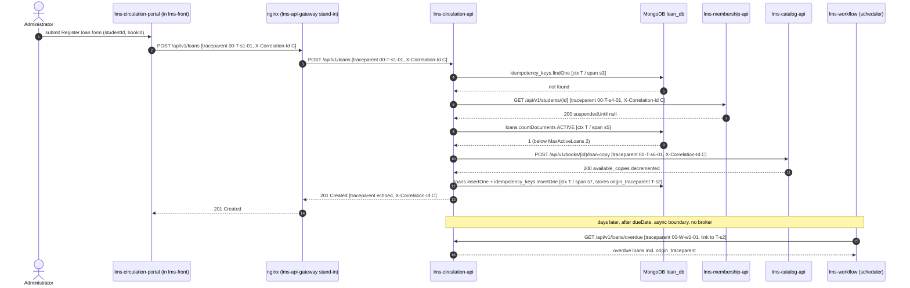

# 01 — Critical Journey and Trace Map

## Journey

**HU-06 — Register a loan** (`POST /api/v1/loans`, EP-004 Loans, Returns & Penalties).

The Administrator at the circulation desk picks a Student and a Book in
`lms-circulation-portal` (loaded as a Module Federation remote inside `lms-front`) and submits
the loan. `lms-circulation-api` then has to coordinate three bounded contexts in one request
(`LoanRegistrationService.RegisterLoan`):

1. Membership: is the Student eligible? (INV-003, no active suspension)
2. Circulation: does the Student already hold `MaxActiveLoans = 2`? (INV-004)
3. Catalog: take one copy of the Book (INV-002, `available_copies > 0`)
4. Circulation: persist the `Loan` aggregate and the `Idempotency-Key`

Why this one: it is the only journey in the system that crosses three services and two
database engines (MongoDB `loan_db` + PostgreSQL `membership_db`/`catalog_db`), it is a
**critical endpoint** in `04-requirements/non-functional.md` (NFR-001: P95 < 300 ms), and it
is the core bounded context (`02-domain/domain-map.md`). If it fails, the desk cannot lend
books at all.

Sources in `library-docs`: `09-microservices/service-catalog.md`,
`09-microservices/dependency-map.md`, `09-microservices/services/05-circulation-service/data-model.md`,
`07-api/contracts/openapi/circulation-service.yaml`, `ADR-008`, `ADR-009`.

## Hops

`lms-api-gateway` is not implemented yet (`service-catalog.md`, status 🔴); today its role is
played by the `/api/v1/` proxy in `lms-circulation-portal/deploy/nginx.conf`. The table shows
the real path.

| Step | Caller | Callee | Protocol | Operation / endpoint | Sync / async | Data store touched | Trace context that travels |
|---|---|---|---|---|---|---|---|
| 1 | `lms-circulation-portal` (apiClient, in the `lms-front` shell) | nginx (stand-in for `lms-api-gateway`) | REST / HTTPS | `POST /api/v1/loans` + `Idempotency-Key` header | sync | — | `traceparent` created by the apiClient (root span) + `X-Correlation-Id` (UUID, already sent today) |
| 2 | nginx | `lms-circulation-api` :8083 | REST / HTTP | `POST /api/v1/loans` | sync | — | `traceparent` and `X-Correlation-Id` forwarded unchanged (`proxy_set_header`) |
| 3 | `lms-circulation-api` | MongoDB `loan_db` | Mongo wire | `idempotency_keys.findOne({_id: key})` | sync | `loan_db.idempotency_keys` | in-process context (`context.Context`), child span `mongo.idempotency_keys.find` |
| 4 | `lms-circulation-api` (`membershipclient`) | `lms-membership-api` :8081 | REST / HTTP, HS256 internal token | `GET /api/v1/students/{studentId}` | sync | `membership_db` → `membership.students` (`suspended_until`) | `traceparent` (new child span id) + `X-Correlation-Id` |
| 5 | `lms-circulation-api` | MongoDB `loan_db` | Mongo wire | `loans.countDocuments({student_id, status: "ACTIVE"})` | sync | `loan_db.loans` | in-process context, child span `mongo.loans.count` |
| 6 | `lms-circulation-api` (`catalogclient`) | `lms-catalog-api` :8082 | REST / HTTP, HS256 internal token | `POST /api/v1/books/{bookId}/loan-copy` | sync | `catalog_db` → `catalog.books` (`available_copies - 1`) | `traceparent` (new child span id) + `X-Correlation-Id` |
| 7 | `lms-circulation-api` | MongoDB `loan_db` | Mongo wire | `loans.insertOne(loan)` + `idempotency_keys.insertOne` | sync | `loan_db.loans`, `loan_db.idempotency_keys` | in-process context; the loan document also stores `origin_traceparent` (new field, see step 8) |
| 8 | `lms-workflow` overdue scanner (ADR-008, polls every 15 min per ADR-009) | `lms-circulation-api` | REST / HTTP | `GET /api/v1/loans/overdue` → saga step A "mark late" | **async** (days later, scheduler-driven, no broker per `AT-002`) | `workflow_db.saga_runs` (PostgreSQL) + `loan_db.loans` | new trace started by the scheduler tick, with a **span link** to the `origin_traceparent` stored on the loan in step 7 |

Step 8 is designed (ADR-008 / ADR-009) but `lms-workflow` still has no code; it is included
because it is the only asynchronous boundary in this journey's lifecycle. There is no message
broker in LMS Library, so the "message header" role is played by the `origin_traceparent`
field persisted on the `loans` document.

## Sequence diagram



`T` = the journey's `trace_id`, `C` = the correlation id, `sN` = span id of each hop,
`W` = the scheduler tick's own `trace_id`.

## Span tree

```text
trace_id T (one per POST /api/v1/loans)
└── s1  CLIENT  lms-circulation-portal  POST /api/v1/loans                (ROOT span)
    └── s2  SERVER  lms-circulation-api  POST /api/v1/loans               (entry span, gets parent s1 from traceparent)
        ├── s3  CLIENT  mongo  loan_db.idempotency_keys.find
        ├── s4  CLIENT  http   GET membership /students/{id}
        │   └── s4a SERVER lms-membership-api GET /api/v1/students/{id}
        │       └── s4b CLIENT postgres SELECT membership.students
        ├── s5  CLIENT  mongo  loan_db.loans.count (ACTIVE)
        ├── s6  CLIENT  http   POST catalog /books/{id}/loan-copy
        │   └── s6a SERVER lms-catalog-api POST /api/v1/books/{id}/loan-copy
        │       └── s6b CLIENT postgres UPDATE catalog.books SET available_copies
        └── s7  CLIENT  mongo  loan_db.loans.insert + idempotency_keys.insert

trace_id W (one per lms-workflow scheduler tick, ADR-009)
└── w1  INTERNAL lms-workflow overdue-scan
    └── w2  CLIENT http GET circulation /loans/overdue
        └── w3  INTERNAL saga.penalty loan_id=...   ── LINK ──▶ (trace T, span s2)   ASYNC BOUNDARY
```

- **Root span:** `s1`, created by the portal's apiClient when it builds the `traceparent`.
- **Child spans:** `s2` (server entry in `lms-circulation-api`) and its children `s3`–`s7`;
  `s4a`/`s6a` are the server spans of the two downstream services, parented by the
  `traceparent` that `membershipclient`/`catalogclient` inject.
- **Span crossing the asynchronous boundary:** `w3 saga.penalty`. It cannot be a child of
  `s2` (the gap is `LoanPeriodDays` = 3 days, a three-day trace would be meaningless), so it
  carries an OpenTelemetry **span link** to `(T, s2)`, read from the `origin_traceparent` field of
  the `loans` document. Searching by `trace_id = T` therefore finds the loan's registration
  and, via the link, its later penalty saga run in `workflow_db.saga_runs`.
