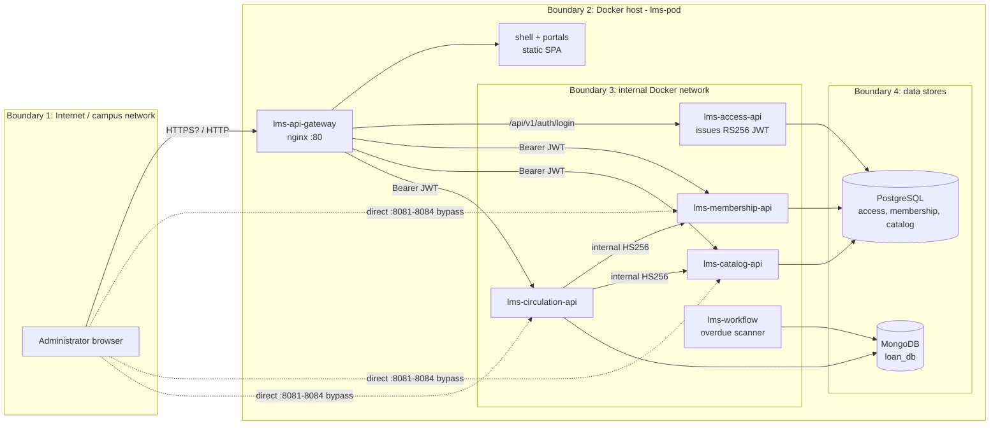

# Week 13 — Session 2: Threat model and security backlog for MVP 3

Built from the real controls in `SECURITY-CONTROLS.md`. Method: data-flow diagram, trust
boundaries, STRIDE per element, then a prioritized backlog with testable criteria and CI security
gates.

## 1. Data flow and trust boundaries



| Boundary | What crosses it | Main control today |
|---|---|---|
| 1 → 2 | Browser requests, login credentials, JWTs | Gateway: header check + rate limit (feature branch only) |
| 2 → 3 | Requests routed to the APIs | RS256 JWT validated in each service |
| 3 → 3 | Circulation calling membership and catalog | HS256 internal token, 1 min, one shared secret |
| 3 → 4 | SQL / Mongo queries | DB credentials from environment variables |

## 2. STRIDE

| # | STRIDE | Element | Threat | Today | Risk |
|---|---|---|---|---|---|
| T1 | **S**poofing | Internal calls | Anyone with `INTERNAL_JWT_SECRET` mints a token with any `sub` and calls any service as if it were a service, or as any Administrator. | One shared secret; `sub` not checked by the callee. | **High** |
| T2 | **E**levation of privilege | Go APIs | Any valid token (even a 1-minute internal one) can call every route, including destructive ones. | No roles, scopes or per-route allow-list. | **High** |
| T3 | **S**poofing / DoS | Gateway bypass | APIs published on host ports `8081`–`8084` skip the gateway's rate limits and fast 401. | Ports published in `lms-pod/compose.yml`. | **High** |
| T4 | **S**poofing | Login | Online password guessing against `/api/v1/auth/login`. | 5 req/min per IP, but only on the unmerged gateway branch; bcrypt cost 12. | Medium |
| T5 | **I**nformation disclosure | Browser ↔ gateway | Credentials and JWTs sniffed on the network if the gateway is served over plain HTTP. | Gateway listens on `:80`; no TLS config. | **High** (once exposed outside localhost) |
| T6 | **T**ampering / **S**poofing | Tokens | A token from another system with the same key is accepted; a stolen token stays valid. | `iss`/`aud` not checked; no revocation; 1 h expiry. | Medium |
| T7 | **D**enial of service | Go APIs, login | Huge request bodies, or very long passwords run through bcrypt. | No `MaxBytesReader`; no length limit on login fields. | Medium |
| T8 | **R**epudiation | All services | An action cannot be tied to a person afterwards. | `sub` and `trace_id` in logs (week 11), but no audit log of changes. | Low |
| T9 | **I**nformation disclosure | Secrets | Secrets leak through git or through vulnerable dependencies. | Secret files git-ignored, but no secret scanning or dependency scanning in CI. | Medium |
| T10 | **T**ampering | Internal network, DBs | Plain HTTP inside Docker, and DB connections without TLS. | Accepted for a single host; not acceptable across hosts. | Low (single host) |

## 3. Prioritized security backlog for MVP 3

Order: high risk first, then what is cheap and closes several threats.

| Pri | ID | Story | Threats | Acceptance criteria (testable) |
|---|---|---|---|---|
| 1 | SEC-01 | Remove the direct host ports of the APIs, so that every client goes through the gateway. | T3 | `lms-pod/compose.yml` publishes no port for the four APIs. `curl localhost:8081/health` fails, and `curl localhost/api/v1/books` with a valid token returns `200` through the gateway. |
| 2 | SEC-02 | Merge the gateway routing and rate-limit config into `develop`. | T3, T4 | `deploy/nginx.conf` is on `develop`. A test sends 8 logins in one minute from the same IP: the 1st to 3rd get a normal answer, and at least one later request gets `429` with `Retry-After`. |
| 3 | SEC-03 | Check which service is calling: each service accepts internal tokens only from an allow-list of callers, per route. | T1, T2 | catalog `POST /books/{id}/loan-copy` accepts a token with `sub=circulation-service` (`200`) and rejects `sub=membership-service` (`403`). A unit test covers both cases. |
| 4 | SEC-04 | Authorize by role or scope: Administrator tokens carry a `role`, internal tokens carry a `scope`, and each route declares what it needs. | T2 | A route without the required role/scope returns `403`. Every protected route has at least one authorization test (allowed and denied). |
| 5 | SEC-05 | Serve the gateway over HTTPS and redirect HTTP to HTTPS. | T5 | `curl -I http://<host>/` returns `301` to `https://`. `https://<host>/health` returns `200` with a valid certificate. The response has `Strict-Transport-Security`. |
| 6 | SEC-06 | Validate `iss` and `aud` in every service. | T6 | A token signed with the right key but with a wrong `iss` or `aud` returns `401`. Tested in each Go API. |
| 7 | SEC-07 | Limit request size and login field length. | T7 | A body over 1 MB returns `413`. A password over 128 characters returns `400 VALIDATION_ERROR` without running bcrypt. |
| 8 | SEC-08 | Add security gates to CI (section 4). | T9, T2 | A PR that adds a fake AWS key, a dependency with a known critical CVE, or a protected route without an auth test fails CI. |
| 9 | SEC-09 | Audit log: write one structured line for every create, update and delete, with `sub`, action, entity ID and `trace_id`. | T8 | After `DELETE /students/{id}`, the log has one line with `action=delete`, the student ID and the Administrator `sub`. |
| 10 | SEC-10 | One internal secret per caller (or mTLS) when the system runs on more than one host. | T1, T10 | Deferred until a multi-host deployment. Decision written as an ADR. |

## 4. Security gates in CI

Added to each API's existing `ci.yml` (it already runs `gofmt`, `go vet` and `go test` on every PR
to `develop`, `qa` and `main`). Each gate is **blocking**.

```yaml
  security:
    runs-on: ubuntu-latest
    timeout-minutes: 10
    steps:
      - uses: actions/checkout@v4
        with:
          fetch-depth: 0
      # Secrets: fail if a credential is committed
      - uses: gitleaks/gitleaks-action@v2
        env:
          GITHUB_TOKEN: ${{ secrets.GITHUB_TOKEN }}
      # Dependencies: fail on known vulnerabilities that are reachable from our code
      - uses: actions/setup-go@v5
        with:
          go-version: "1.25"
      - run: go install golang.org/x/vuln/cmd/govulncheck@latest
      - run: govulncheck ./...
      # Authorization tests: run the auth middleware tests on their own,
      # so that a PR can never silently skip them
      - name: authz tests
        run: go test ./internal/adapter/in/httpapi/middleware/... -run 'Auth|Authz' -count=1
```

For the Node.js service (`lms-access-api`) and the portals, the dependency gate is
`npm audit --audit-level=high`, plus the same gitleaks step.

These gates only block merges once they are set as **required status checks** in branch
protection. Today `develop`, `qa` and `main` have no required checks (only `main` requires one
review). That is part of week 14.

## Next week

CI/CD end to end: required checks, branch protection, image build and deploy.
