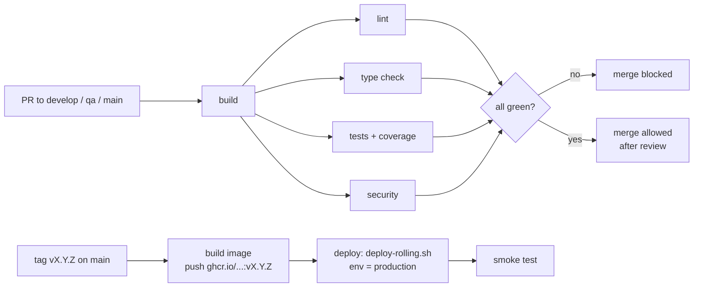

# Week 14 — Session 1: Setting up CI/CD

Where the LMS pipelines are today (checked in each repo's `.github/workflows/` and in GitHub branch
protection), and the pipeline each repo needs: blocking gates on every PR, a protected `main`, and
automatic deployment of the tagged image.

## 1. Current state

| Repo group | Workflow today | What it runs on PRs to `develop` / `qa` / `main` |
|---|---|---|
| Go APIs: `lms-catalog-api`, `lms-circulation-api`, `lms-membership-api` | `ci.yml` (identical in all three) | `gofmt` check, `go vet`, `go test ./...` |
| Portals: `lms-access-portal`, `lms-circulation-portal`, `lms-membership-portal` | `ci.yml` | `npm ci`, `npm run build` |
| `lms-access-api` (Node.js), `lms-api-gateway`, `lms-worker`, `lms-workflow`, `lms-front`, `lms-catalog-portal`, `lms-pod` | **none** | nothing |

Branch protection (GitHub API, `lms-catalog-api` and `lms-circulation-api`):

| Branch | Required reviews | Required status checks |
|---|---|---|
| `develop` | 0 | none |
| `qa` | 0 | none |
| `main` | 1 | none |

**So today CI is advisory.** A PR can merge with a red build, because no check is required. There
is no lint beyond `gofmt`/`go vet`, no coverage, no security scan, no image build, and no
deployment from CI. There is also no container registry (accepted gap, ADR-006).

## 2. Target pipeline (per service repo)



### 2.1 Gates on every PR (all blocking)

| Gate | Go APIs | Node.js API and portals |
|---|---|---|
| Build | `go build ./...` | `npm ci && npm run build` |
| Lint | `golangci-lint run` (includes `gofmt`, `govet`, `errcheck`, `staticcheck`) | `oxlint` (already in `lms-access-api`), `eslint` in the portals |
| Type check | Covered by the Go compiler and `go vet` | `vue-tsc --noEmit` in portals that use TypeScript |
| Tests | `go test -race ./...` | `npm test` |
| Coverage | `go test -coverprofile`; fail if total coverage is below the baseline (start at the current value, rounded down) | `node --test --experimental-test-coverage` / Vitest coverage threshold |
| Security | gitleaks, `govulncheck`, authorization tests (week 13, `THREAT-MODEL.md` §4) | gitleaks, `npm audit --audit-level=high` |

`ci.yml` for the Go APIs (replaces the current one):

```yaml
name: CI
on:
  pull_request:
    branches: [develop, qa, main]
  workflow_dispatch:
permissions:
  contents: read
jobs:
  build:
    runs-on: ubuntu-latest
    timeout-minutes: 10
    steps:
      - uses: actions/checkout@v4
      - uses: actions/setup-go@v5
        with: { go-version: "1.25" }
      - run: go build ./...

  lint:
    needs: build
    runs-on: ubuntu-latest
    steps:
      - uses: actions/checkout@v4
      - uses: actions/setup-go@v5
        with: { go-version: "1.25" }
      - uses: golangci/golangci-lint-action@v6
        with: { version: v1.61.0 }

  test:
    needs: build
    runs-on: ubuntu-latest
    env:
      COVERAGE_MIN: "60"   # baseline; raise it as coverage grows, never lower it
    steps:
      - uses: actions/checkout@v4
      - uses: actions/setup-go@v5
        with: { go-version: "1.25" }
      - run: go test -race -coverprofile=coverage.out ./...
      - name: coverage gate
        run: |
          total=$(go tool cover -func=coverage.out | awk '/^total:/ {print int($3)}')
          echo "coverage: ${total}% (min ${COVERAGE_MIN}%)"
          [ "$total" -ge "$COVERAGE_MIN" ]

  security:
    needs: build
    runs-on: ubuntu-latest
    steps:
      - uses: actions/checkout@v4
        with: { fetch-depth: 0 }
      - uses: gitleaks/gitleaks-action@v2
        env: { GITHUB_TOKEN: "${{ secrets.GITHUB_TOKEN }}" }
      - uses: actions/setup-go@v5
        with: { go-version: "1.25" }
      - run: go install golang.org/x/vuln/cmd/govulncheck@latest && govulncheck ./...
      - run: go test ./internal/adapter/in/httpapi/middleware/... -count=1
```

The coverage baseline (`60`) is a placeholder. The first run on each repo sets the real baseline,
and the value is written in that repo's README.

### 2.2 Protect `main`

On `main` in every service repo: a PR is required, with 1 approval, all four jobs (`build`, `lint`,
`test`, `security`) as **required status checks**, the branch up to date before merging, and no
force push or deletion. Settings for `develop` and `qa` are in `DOD-GATES.md` §2.

### 2.3 Automated deployment of the tagged image

The team already promotes code by git tag (`develop` → `qa` → `main`, cherry-pick model) and
deploys with the week 12 script `deploy-rolling.sh`. CD automates those same steps:

```yaml
name: CD
on:
  push:
    tags: ["v*.*.*"]
permissions:
  contents: read
  packages: write
jobs:
  image:
    runs-on: ubuntu-latest
    steps:
      - uses: actions/checkout@v4
      - uses: docker/login-action@v3
        with:
          registry: ghcr.io
          username: ${{ github.actor }}
          password: ${{ secrets.GITHUB_TOKEN }}
      - uses: docker/build-push-action@v6
        with:
          context: .
          file: deploy/Dockerfile
          push: true
          tags: ghcr.io/code-corhuila/${{ github.event.repository.name }}:${{ github.ref_name }}

  deploy:
    needs: image
    runs-on: ubuntu-latest
    environment: production        # needs approval in the GitHub environment settings
    steps:
      - name: rolling deploy on the host
        uses: appleboy/ssh-action@v1
        with:
          host: ${{ secrets.DEPLOY_HOST }}
          username: ${{ secrets.DEPLOY_USER }}
          key: ${{ secrets.DEPLOY_SSH_KEY }}
          script: |
            cd /opt/lms-pod
            ./deploy-rolling.sh ${{ github.event.repository.name }} ${{ github.ref_name }}
            ./smoke-test.sh
```

- **The same image** that was built for the tag is the one deployed. There is no rebuild per
  environment, which closes the ADR-006 gap of rebuilding locally.
- The `production` environment requires a manual approval, and the deploy job only runs for tags.
- **Rollback** is the same job run on the previous tag (`workflow_dispatch` with a tag input), as
  rehearsed in week 12.
- `smoke-test.sh` is defined in `DOD-GATES.md` §5.

## 3. Gaps that block this today

- There is no deploy host reachable from GitHub Actions yet (week 12: deployment on a local Docker
  host). Until there is one, the `deploy` job stops after `image`, and the deploy is run by hand with
  the same script and tag.
- `deploy-rolling.sh` must change from "build from git tag" to "pull image tag from GHCR".
- 7 repos have no workflow at all (see section 1). They get the same template.
